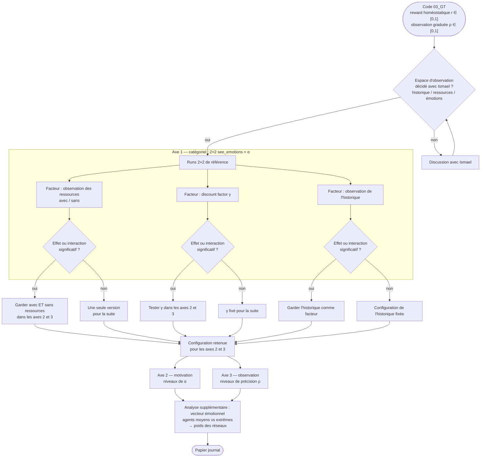

# Suivi des expériences — version journal (03_GT) et révision AIS 2026

La première partie concerne la **version journal (03_GT)**. La seconde partie
(à partir de « Révision AIS 2026 ») est l'historique hérité de 02_GT_AIS.

---

# Version journal — 03_GT

## Plan du papier (réunion, notes du 02/10/2026)

**Discussions préalables (avis d'Ismael + réflexion de notre côté) :**

1. Décider de l'espace d'observation avec Ismael (historique / ressources /
   émotions) → tester ce qui a un impact.
2. Changer la forme de la reward (rotation sur un même intervalle).

**Structure du papier — trois axes :**

1. **Catégoriel** (2×2 see_emotions × α). S'il y a interaction avec les
   facteurs ci-dessous, on les reteste dans les axes 2 et 3.
   - observation des ressources : avec / sans → si important, on garde les deux ;
   - effet du discount factor γ → si important, on le fait pour les deux ;
   - tester l'effet de l'observation de l'historique (repas propres).
2. **Motivation** — niveaux de α.
   - observation des ressources : avec / sans (option) ;
   - effet du discount factor (option).
3. **Observation** — bruit dans l'observation des émotions (précision ρ).
   - observation des ressources : avec / sans (option) ;
   - effet du discount factor (option).

**Analyse supplémentaire :**
1. Vecteur émotionnel — propriétés émergentes (agents moyens vs agents extrêmes). Méthode retenue le 14/10/2026 : sondes comportementales sur les réseaux entraînés plutôt que lecture des poids (voir le tableau d'avancement et la méthode journal).
2. **Dépendance à la dynamique de la ressource (politiques gelées)** : tester les agents entraînés sur la ressource qui dépérit dans un environnement où la ressource se renouvelle (sans réapprentissage, ε = 0), pour évaluer si l'apprentissage est strictement dépendant de la trajectoire de déclin inéluctable ou s'il a acquis une règle de régulation fonctionnelle robuste, et mesurer leur niveau d'optimalité par rapport au Maximum Sustainable Yield (MSY).

## Logique de construction



## Avancement 03_GT

| Chantier | Statut | Où |
|---|---|---|
| Reward homéostatique (seuls les repas rapportent, 1 − h), intervalle [0, 1] pour tout α (point 2 des discussions) | 🟢 codé et vérifié | `SocialRewardCalculator`, [analysis_00](analysis/analysis_00_reward_observation_checks.ipynb) §2 |
| Observation continue des émotions sur [0, 1], même grandeur que ẽ (précision ρ : uniforme → Dirac) — prérequis de l'axe 3 | 🟢 codé et vérifié | `perceive_bounded`, [analysis_00](analysis/analysis_00_reward_observation_checks.ipynb) §3 |
| Bug `env.reset()` (observation initiale de l'épisode précédent) | 🟢 corrigé | `env.reset` |
| Discount factor social γ_o (DQN à deux têtes, combinaison brute) + `exp7_social_discount` (γ_o des deux côtés de γ, contrôles « α apparié ») | 🟢 codé et testé (équivalence γ_o = γ, mini-runs) — 🔴 pas lancé | `DQNAgent`, [analysis_01](analysis/analysis_01_social_discount_factor.ipynb) |
| Bug « action stockée ≠ action jouée » | 🟢 corrigé (`Agent.act`) | `run_step` |
| Observation des émotions individuelles des 5 autres (`EMOTION_TYPE = "vector"`, observation 3 → 7 dimensions) au lieu de la moyenne ; la reward empathique reste la moyenne | 🟢 basculé le 02/10/2026, analysis_00 adapté (34/34 vérifications) | `main_gt_ais.EMOTION_TYPE`, `env.get_observations` |
| Premier batch exp1 (reward `homeostatic`, 3 seeds) : la politique greedy converge en 1–3 épisodes (évaluations denses, `exp1_resource_obs_early`) ; 500 repas par épisode quoi qu'il arrive, reward empathique totale constante (83,2) → manger est toujours mieux que s'abstenir | 🟢 analysé le 04–05/10/2026 | [analysis_exp1](analysis/analysis_exp1_resource_obs.ipynb) |
| Évaluations denses (épisode −1 + 20 premiers) sans effet sur l'entraînement, poids initiaux/finaux des DQN sauvegardés | 🟢 codé et vérifié | `run_simulation`, `save_weights` |
| Reward de retenue `homeostatic_restraint` : bonus α·abstention·max(0, s_i − s̄_{-i}) à la place de α·ẽ — s'abstenir devient préférable quand on est mieux loti que les autres (retour sur la décision du 02/10 : la retenue devient une motivation codée, plus un pur résultat) | 🟡 codé, règle de décision vérifiée, pilote en cours — 🔴 batch exp1 à relancer | `SocialRewardCalculator.restraint_bonus` |
| Test de dépendance à la dynamique (politiques gelées sur ressource renouvelable) : régénération logistique R ← min(K, R − C + rR(1 − R/K)), sur les politiques de l'axe 1 d'abord, K = 500, r = 0,01 (rK = 5 < 6 : « toujours exploiter » effondre la ressource, rendement max soutenable 1,25 repas/pas ; décidé le 14/10/2026, justification dans la méthode journal) | 🔴 planifié (valorise les poids sauvegardés, cf. [agy_tracker](agy_tracker.md) Axe E) | `main_gt_ais` (mode eval cross-env) |
| Espace d'observation (point 1 des discussions) | 🟢 décidé le 14/10/2026 : historique propre toujours observé, observation de la ressource testée comme modérateur à l'axe 1 | [méthode journal](../journal_paper/method.tex) |
| Définition des conditions des axes 1–3 dans `main_gt_ais.EXPERIMENTS` | 🔴 | |
| Historique des repas initialisé à 0,5 (neutre) au lieu de 0 à chaque épisode : satiété et émotion partent du neutre au lieu d'une faim maximale | 🟢 implémenté et vérifié le 27/10/2026 (décidé le 14/10/2026) — les runs lancés avant (pilotes, lots 1 et 2 de `main_beta`) ne sont plus réutilisables | `Agent.__init__` et `Agent.reset` : `deque([0.5] * memory_size)`, `satiety_before_meal = 0.5` |
| Empreinte du code `code_version` dans le JSON de chaque run (condition pour réutiliser un run entre expériences) | 🔴 à implémenter (décidé le 14/10/2026, méthode testée sur une copie, voir ci-dessous) | `write_run_config` |
| `exp2_replication_no_res` (modérateur ressource) : garder l'historique propre visible (`see_own_meals=True`) pour isoler l'effet de l'observation de la ressource (aujourd'hui caché comme dans le papier de conférence) | 🔴 à implémenter avant les runs (décidé le 14/10/2026) | `EXPERIMENTS["exp2_replication_no_res"]` |
| Ajouter les conditions B et C à `exp5_gamma_robustness` pour chaque γ ∈ {0,8 ; 0,9 ; 0,999} : le 2×2 complet est nécessaire pour l'ANOVA γ × ρ × α (aujourd'hui A et D seulement) | 🔴 à implémenter (décidé le 14/10/2026) | `EXPERIMENTS["exp5_gamma_robustness"]` |
| Analyse de la lecture des émotions individuelles par sondes (notebook) : (1) rejouer des épisodes greedy avec les poids finaux (`<run>_weights.pt`) pour collecter les observations réellement visitées (les observations pas à pas ne sont pas enregistrées) ; (2) remplacer les 5 cases sociales par des vecteurs contrôlés où un pair, à position aléatoire, s'écarte des 4 autres (moyenne et valeur extrême varient indépendamment) ; (3) réponse ΔQ = Q(o, manger) − Q(o, s'abstenir) ; (4) régression de ΔQ sur la moyenne et la valeur déviante → lecture « moyenne » vs attention au pair extrême, et comparaison selon la position → certains pairs comptent-ils plus ? ; (5) comparer C, D, niveaux des axes 2 et 3 : la motivation empathique oriente-t-elle l'attention vers le pair le plus en manque (mécanisme candidat de la hausse du Gini, cf. [agy_tracker](agy_tracker.md) B.1) | 🔴 à faire (décidé le 14/10/2026), aucun changement du code de simulation | nouveau notebook `analysis/` |
| Apprentissage tous les 4 pas : ajouter `"learn_every": 4` à `PARAMS_DQN` (paramètre déjà supporté par `DQNAgent`, défaut 1) | 🔴 à implémenter (décidé le 27/10/2026, cf. Mnih et al. 2015) | `main_gt_ais.PARAMS_DQN` |
| Politiques de référence (aléatoire, toujours exploiter, toujours s'abstenir) : pas de simulation dans le pipeline d'entraînement, valeurs calculées directement depuis la dynamique de la ressource (Monte Carlo, 5 000 épisodes) : toujours exploiter 563 pas (ET 105), Gini 0,036 ; aléatoire 975 pas (ET 51), 71 % censurés, Gini 0,045 ; toujours s'abstenir 1000 pas, aucun repas | 🟢 décidé et calculé le 27/10/2026 (remplace l'ajout de `always_abstain` à `exp3`) | méthode journal |
| Seed dérivé de la configuration + numéro de réplication, au lieu de la position de la condition dans l'expérience ; résultats rangés par configuration, pour qu'une condition commune à plusieurs expériences (A–D) ne soit calculée qu'une fois | 🔴 à implémenter (décidé le 14/10/2026) | formule du seed dans `main`, dossiers de résultats |

### Empreinte du code (à implémenter)

Hash du code de simulation **sans commentaires, docstrings ni lignes vides** :
modifier un commentaire ne change pas l'empreinte, modifier une ligne de code la
change. On hache le texte lui-même (`ast`/`tokenize` ne servent qu'à repérer
commentaires et docstrings par position), donc l'empreinte ne dépend pas de la
version de Python, contrairement à `ast.dump`. Pour `main_gt_ais.py`, seules
les fonctions qui exécutent la simulation comptent : ajouter une expérience
dans `EXPERIMENTS` ne change pas l'empreinte (les paramètres de chaque run sont
déjà dans son JSON). Testé le 14/10/2026 sur des copies : commentaire, docstring,
ligne vide et nouvelle expérience → empreinte inchangée ; une ligne ajoutée dans
`run_step` → empreinte différente. Pas de constante de version manuelle.

À ajouter dans `main_gt_ais.py`, puis `"code_version": code_version(),` dans le
dictionnaire `config` de `write_run_config` :

```python
import ast, hashlib, io, tokenize

# functions of main_gt_ais.py that run the simulation; every other parameter of
# a run (constants, conditions) is already written in its JSON config
RUNNER_FUNCTIONS = {"init_env", "gini", "run_step", "run_eval_episode",
                    "run_simulation", "set_global_seed"}


def _code_text(path, only_functions=None):
    """source without comments, docstrings, blank lines and trailing spaces.
    works on the text itself (positions from ast/tokenize), so the result does
    not depend on the Python version, unlike ast.dump."""
    with open(path, encoding="utf-8") as f:
        src = f.read()
    lines = src.splitlines()
    tree = ast.parse(src)
    for tok in tokenize.generate_tokens(io.StringIO(src).readline):
        if tok.type == tokenize.COMMENT:
            row, col = tok.start
            lines[row - 1] = lines[row - 1][:col]
    drop = set()
    for node in ast.walk(tree):
        if isinstance(node, (ast.Module, ast.ClassDef, ast.FunctionDef, ast.AsyncFunctionDef)) and node.body:
            first = node.body[0]
            if isinstance(first, ast.Expr) and isinstance(first.value, ast.Constant) \
                    and isinstance(first.value.value, str):
                drop.update(range(first.lineno - 1, first.end_lineno))
    keep = range(len(lines))
    if only_functions is not None:
        keep = {i for n in tree.body if isinstance(n, ast.FunctionDef) and n.name in only_functions
                for i in range(n.lineno - 1, n.end_lineno)}
    return "\n".join(lines[i].rstrip() for i in sorted(keep)
                     if i not in drop and lines[i].strip())


def code_version():
    """short sha256 of the simulation code, ignoring comments and docstrings."""
    here = os.path.dirname(os.path.abspath(__file__))  # _script_dir is local to main()
    h = hashlib.sha256()
    h.update(_code_text(os.path.join(here, "env_gt_ais.py")).encode())
    h.update(_code_text(os.path.join(here, "agent_policies_gt_ais.py")).encode())
    h.update(_code_text(os.path.join(here, "main_gt_ais.py"), RUNNER_FUNCTIONS).encode())
    return h.hexdigest()[:12]
```

Attention : si une fonction de `main_gt_ais.py` qui influence la simulation est
ajoutée ou renommée, l'ajouter à `RUNNER_FUNCTIONS`.

## Questions à discuter (03_GT)

- [ ] **ẽ (reward) et x (observation émotionnelle) ne devraient-ils pas être la
      même grandeur maintenant ?**
      - ~~échelle différente~~ → **tranché le 02/10/2026 : tout sur [0, 1].**
        L'observation x est ẽ = (ē + 1)/2 elle-même (vérifié dans analysis_00
        §2.1 et §3.3). Une version tout sur [−1, 1] a été essayée puis
        abandonnée : avec l'abstention à −1, la reward moyenne d'un agent
        égoïste était au mieux −0,5 par pas, donc épuiser la ressource (fin
        d'épisode, retour futur 0) devenait payant. Sur [0, 1], les rewards après
        un épuisement seraient ≈ 0 de toute façon : arrêter l'épisode à
        l'épuisement est équivalent à le continuer, aucune pénalité terminale
        n'est nécessaire ;
      - **reste ouvert — vraie valeur vs valeur perçue** : la reward empathique est calculée sur
        la vraie émotion, alors que l'agent ne voit que x̂ (bruitée à ρ < 1).
        Faut-il récompenser l'agent sur ce qu'il perçoit (ẽ calculé à partir de
        x̂), de sorte que ρ agisse à la fois sur l'observation et sur la
        motivation ? Attention : c'est ce découplage qui permet la condition B du
        2×2 (« aveugle mais récompense empathique ») ; unifier les deux
        changerait le sens de cette condition.
- [x] ~~**Faire apprendre la retenue conditionnée à l'émotion des autres
      (discussion du 02/10/2026).**~~ → **abandonné le 02/10/2026** : on ne
      modifie ni l'environnement (pas de concurrence par pas) ni le terme
      empathique (pas de priorité aux plus mal lotis). Avec « seuls les repas rapportent », manger
      n'est jamais pire que s'abstenir sur le pas immédiat : la retenue ne peut
      s'apprendre que par ses conséquences futures (γ). Le chemin « ma
      consommation → émotion des autres » passe par la ressource et il est
      très faible (1 unité sur 500). Piste privilégiée : garder la reward telle
      quelle (la retenue reste un *résultat*, pas une hypothèse codée) et
      renforcer ce lien dans l'environnement, par ex. concurrence par pas (si
      plus d'agents exploitent que de ressource disponible, certains échouent).
      À discuter avec Ismael.
      → Proposition étudiée (notebook analysis_01, supprimé depuis ; rien de
      codé dans la simulation). Deux ingrédients qui englobent le
      modèle actuel : concurrence par pas (`meals_per_step` k) et priorité aux
      plus mal lotis dans le terme empathique (`empathy_priority` λ). Sur un
      modèle jouet résolu exactement, seule leur combinaison rend la retenue
      dépendante de l'état des autres.
- [ ] Point d'équilibre homéostatique implicite : l'optimum de consommation est
      f = 0,5 (= `THRESHOLD`) par construction de p = repas × (1 − h).
- [ ] L'émotion émise reste croissante avec la consommation, alors que la reward
      personnelle est homéostatique : faut-il rendre l'émotion homéostatique
      aussi ?
- [ ] `see_emotions=False` donne maintenant un bruit uniforme au lieu d'un 0
      constant (les conditions « aveugles » ne sont plus identiques bit à bit à
      celles de l'AIS).
- [x] ~~**Bug ouvert, non corrigé :** dans `main_gt_ais.run_step`, l'action stockée
      dans le replay buffer vient d'un second tirage ε-greedy, différent de
      l'action jouée (≈47 % des transitions à ε = 1, ≈1 % à ε = 0,01).~~ →
      **corrigé dans 03_GT le 02/10/2026** (`Agent.act`, la première transition
      de chaque épisode est aussi conservée). Toujours présent dans 02_GT_AIS et
      donc dans les runs AIS.
- [ ] **Discount factor social γ_o (02/10/2026).** Codé (combinaison brute, pas de
      normalisation). La littérature (Osiński & Karbowski 2017 ; van Rijn et al.
      2024) suggère plutôt γ_o ≥ γ_s pour des récompenses monétaires, donc la
      grille explore les deux côtés. Reste à décider où placer exp7 dans le
      plan du papier (axe 2 ?) et à la lancer.
- [ ] **Dépendance à la dynamique de la ressource & optimalité hors-distribution :** exploiter
      les poids sauvegardés (`<run>_weights.pt`) pour tester les politiques gelées (sans réapprentissage,
      ε = 0) dans une condition où la ressource se régénère. Question : l'apprentissage a-t-il sur-appris
      la trajectoire de déclin inéluctable (horloge temporelle de fin d'épisode) ou acquis une heuristique
      de régulation fonctionnelle ? Quel est le niveau d'optimalité par rapport au Maximum Sustainable
      Yield (MSY) ? (Détails et protocole : cf. `agy_tracker.md` Axe E).

---

# Révision AIS 2026 (soumission 1885) — historique 02_GT_AIS

Document de suivi : quelles expériences existaient dans le manuscrit soumis,
lesquelles sont à refaire, lesquelles n'ont **jamais été faites**, et où on en
est. Mettre à jour les cases au fur et à mesure.

**Légende statut :**
- 🟢 fait et validé
- 🟡 en cours / partiel
- 🔴 pas commencé
- 📄 = existait dans le manuscrit soumis (mais avec les limites ci-dessous)

**Limites communes à TOUS les runs du manuscrit soumis** (donc tout résultat
📄 doit être re-vérifié sous le régime corrigé) :
1. observation sans niveau de ressource (bottleneck pointé par R1) ;
2. replay buffer vidé à chaque épisode ;
3. epsilon décroissant par pas → exploration morte dès l'épisode 1 ;
4. seulement 4 seeds par condition (F(1,12)).

---

## Vue d'ensemble

| Expérience | Existait dans le papier ? | Runs (x20 seeds) | Analyse stats | Figures | Texte manuscrit |
|---|---|---|---|---|---|
| exp1_resource_obs (2×2 avec r_t) | ❌ jamais fait | 🔴 | 🔴 | 🔴 | 🔴 |
| exp2_replication_no_res (2×2 du papier, entraînement corrigé) | 📄 (4 seeds, entraînement biaisé) | 🔴 | 🔴 | 🔴 | 🔴 |
| exp3_fixed_baselines (random / always_exploit) | ❌ jamais fait | 🔴 | 🔴 | 🔴 | 🔴 |
| exp4_inequity_aversion (Hughes 2018) | ❌ jamais fait | 🔴 | 🔴 | 🔴 | 🔴 |
| exp5_gamma_robustness (γ ∈ {0.9, 0.999}) | ❌ jamais fait | 🔴 | 🔴 | 🔴 | 🔴 |
| exp6_graded_alpha (Study 2 du papier, α gradué) | 📄 (4 seeds/niveau, sans r_t, entraînement biaisé) | 🔴 | 🔴 | 🔴 | 🔴 |

---

## Détail par expérience

### exp1_resource_obs — le re-run principal (R1) — ❌ jamais fait
2×2 (see_emotions × alpha), tous les agents observent r_t/r_0.

| Condition | Runs 20 seeds | CSV complets | Remarques |
|---|---|---|---|
| A_res_blind_non_empathic | 🔴 | 🔴 | |
| B_res_blind_reward_empathic | 🔴 | 🔴 | |
| C_res_sees_ignores | 🔴 | 🔴 | condition critique : l'effet « observation » survit-il à r_t ? |
| D_res_full_empathy | 🔴 | 🔴 | |

- [ ] ANOVA 2×2 sur la durée de vie de la ressource (total_steps) — F(1,76) avec 20 seeds
- [ ] ANOVA 2×2 sur l'inégalité (gini_meals, fin d'entraînement)
- [ ] Comparaison C vs A : le signal émotionnel apporte-t-il encore de l'information au-delà de r_t ?
- [ ] Le résultat sub-additif / paradoxal du papier se reproduit-il ?

### exp2_replication_no_res — pont avec le papier — 📄 partiellement fait
Les 4 conditions du manuscrit (sans r_t), mais : buffer persistant, epsilon par
épisode, 20 seeds. Sert à distinguer « l'effet disparaît car l'entraînement
était biaisé » de « l'effet disparaît car les agents voient la ressource ».

| Condition | Fait dans le papier | À refaire (corrigé, 20 seeds) |
|---|---|---|
| A_nores_blind_non_empathic | 📄 4 seeds | 🔴 |
| B_nores_blind_reward_empathic | 📄 4 seeds | 🔴 |
| C_nores_sees_ignores | 📄 4 seeds | 🔴 |
| D_nores_full_empathy | 📄 4 seeds | 🔴 |

- [ ] Les effets principaux (durée de vie ↑ avec empathie) se reproduisent-ils ?
- [ ] Le renversement de fairness (inégalité ↑ avec empathie) se reproduit-il ? (demande explicite de R2)

### exp3_fixed_baselines — points de référence — ❌ jamais fait
| Condition | Runs | Rôle |
|---|---|---|
| random_policy | 🔴 | plancher de référence |
| always_exploit | 🔴 | vitesse de déplétion maximale (borne basse de durée de vie) |
| (always_abstain) | ⚪ optionnel | disponible dans le code si besoin d'une borne haute triviale |

- [ ] Situer chaque condition DQN entre ces bornes dans une figure

### exp4_inequity_aversion — baseline littérature (R2) — ❌ jamais fait
DQN avec récompense subjective de Hughes et al. 2018 (α_ia=0, β_ia=0.5,
λ=0.95), mêmes observations que D_res.

- [ ] Runs 20 seeds 🔴
- [ ] Comparaison IA vs D_res sur durée de vie ET Gini — c'est LA réponse
      empirique à « How does your mechanism differ from Hughes, and would you
      expect their equality result to survive under your affective-signal channel? »
- [ ] Éventuel balayage β_ia si le résultat est ambigu (⚪ non planifié)

### exp5_gamma_robustness — robustesse (R2) — ❌ jamais fait
| Condition | Runs |
|---|---|
| A_res_gamma090 | 🔴 |
| D_res_gamma090 | 🔴 |
| A_res_gamma0999 | 🔴 |
| D_res_gamma0999 | 🔴 |

- [ ] Le renversement de fairness persiste-t-il à γ = 0.9 et 0.999 ?
- [ ] ⚪ optionnel : compléter B et C si A/D montrent une sensibilité à γ

### exp6_graded_alpha — Study 2 du papier (dose-réponse) — 📄 partiellement fait
α ∈ {0, 0.25, 0.5, 0.75, 0.99}, observation active, avec r_t, régime corrigé.
Dans le papier : Spearman r_s(18)=.92 (durée de vie) et .96 (Gini) sur 4 seeds
par niveau, TH3 confirmée, TH4 contredite (inégalité ↑ avec α).

| Condition | Fait dans le papier | À refaire (corrigé, 20 seeds) |
|---|---|---|
| alpha000_res | 📄 4 seeds sans r_t | 🔴 |
| alpha025_res | 📄 4 seeds sans r_t | 🔴 |
| alpha050_res | 📄 4 seeds sans r_t | 🔴 |
| alpha075_res | 📄 4 seeds sans r_t | 🔴 |
| alpha099_res | 📄 4 seeds sans r_t | 🔴 |

- [ ] Les corrélations de Spearman (TH3 ↑ durée de vie, TH4 ↑ Gini) tiennent-elles ?
- [ ] ⚠️ à α=0.99, la part personnelle de la récompense est quasi nulle : vérifier
      (vs baseline `always_abstain`) que la « soutenabilité » à haut α n'est pas
      juste l'extinction de l'incitation à consommer — comparaison clé pour
      l'interprétation du dose-réponse

---

## Chantiers hors code (manuscrit)

- [ ] 🔴 Reframing des hypothèses en « claim de suffisance » (R2) : cette
      formalisation de l'empathie **suffit** à produire la soutenabilité, avec
      l'inégalité comme conséquence non anticipée — au lieu de valider/invalider
      la théorie empathie-altruisme
- [ ] 🔴 Corriger les incohérences figures ↔ texte (R1 : « massive, highly
      confusing contradiction ») — à faire figure par figure une fois les
      nouvelles données disponibles
- [ ] 🔴 Typos et légendes (R1)
- [ ] 🔴 Ajouter la discussion de la littérature : Hughes et al. 2018, prosocial
      reward shaping, emotion-mediated cooperation (arXiv:1906.10918) ; retirer
      ou nuancer la phrase « no existing work … » (§1.2, p.3)
- [ ] 🔴 Décrire honnêtement l'ancien régime d'entraînement vs le nouveau
      (buffer, epsilon) dans la section méthode
- [ ] 🔴 Resoumission via EasyChair : https://easychair.org/conferences/overview?a=37322171

---

## Décisions tranchées

- [x] 24/07/2026 — observation de l'état interne propre : slot
      `sum(meal_history)/10` ajouté à l'observation (`see_own_meals`), actif
      partout sauf exp2 (fidélité aux conditions du papier). Règle le problème
      de récompense non-markovienne (cf. NOTES_ANALYSE_REVIEWS.md §3.5).
- [x] 24/07/2026 — évaluation greedy périodique : tous les 10 épisodes
      d'entraînement, 1 épisode ε=0 sans apprentissage, `phase='eval'` dans les
      CSV. **Les analyses finales se font sur les lignes eval.** Règle le
      problème « mesures pendant l'entraînement » (NOTES §3.6).
- [x] 24/07/2026 — parallélisation par machines : `--runs` (défaut 1) et
      `--sim-start` en CLI ; répartition 3 machines = sim 0-6 / 7-13 / 14-19
      pour atteindre 20 seeds/condition. Priorité de lancement : exp1 + exp6
      (les deux études du papier), le reste ensuite.

## Décisions à discuter (pas encore tranchées)

- [ ] `include_time` (indicateur temporel dans l'observation) : R1 le mentionne
      comme alternative — actuellement désactivé (`INCLUDE_TIME=False`)
- [ ] epsilon_decay par épisode = 0.99 (min atteint ~épisode 460) : valider ce
      choix ou tester 0.985
- [ ] faut-il aussi une ANOVA à 3 facteurs (see_resource × see_emotions × alpha)
      en combinant exp1+exp2 plutôt que deux ANOVA 2×2 ?
- [x] R1 exige-t-il des runs « emotion_type=vector » ? (actuellement average,
      comme dans le papier) → dans 03_GT, `vector` est le défaut depuis le 02/10/2026
- [ ] mixed populations (agents empathiques + égoïstes mélangés) : supporté par
      le code (configs par agent) mais hors périmètre de la révision
